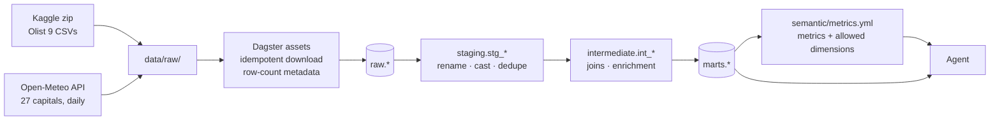
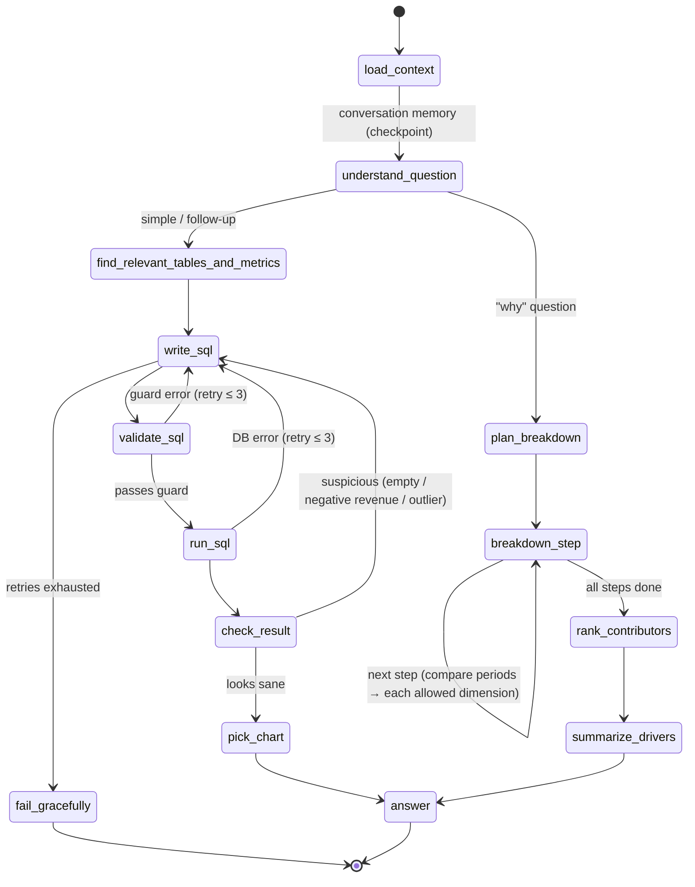

# Architecture — AI Data Analyst ("Ask your data")

## 1. Overview

A user asks a business question in plain English. A LangGraph agent finds the
relevant tables and metrics, writes SQL, checks it against a guard, runs it on a
read-only DuckDB connection, sanity-checks the result, picks a chart, and
explains the answer together with the SQL it used. Follow-up questions keep the
conversation context. "Why" questions are broken into a multi-step breakdown
(by period, region, category, …) that ranks the main drivers.

Everything runs locally for $0: open data, open-source tools, and a local LLM
through Ollama (default `qwen2.5-coder:7b`). The provider can be swapped with
env vars.

### Datasets

| Dataset | Source | Size | Coverage | License | Used for |
|---|---|---|---|---|---|
| Olist Brazilian E-Commerce | Kaggle (`olistbr/brazilian-ecommerce`), needs a free Kaggle API token in `.env` | ~120 MB, 9 CSVs | ~100k orders, 2016-09 → 2018-10 | CC BY-NC-SA 4.0 | orders, items, payments, reviews, customers, sellers, products |
| Open-Meteo Historical Weather | `archive-api.open-meteo.com`, no key | < 5 MB JSON | Daily, the 27 Brazilian state capitals, same date range | CC BY 4.0 | `temp_max`, `temp_min`, `precipitation_sum` per state per day |

**How they join:** customer state + order date ↔ the capital of that state +
weather date. That supports questions like "Did rainy days hurt revenue in São
Paulo?" and gives a natural `region` (Brazilian macro-region) for row-level
security.

---

## 2. System

```mermaid
flowchart LR
    user([User / browser])

    subgraph web["web/ — Next.js + TS + Tailwind + ECharts"]
        ui[Chat page<br/>dashboards]
    end

    subgraph api["api/ — FastAPI"]
        routes[POST /ask SSE<br/>GET /history<br/>POST /dashboards<br/>POST /login]
        auth[JWT auth<br/>rate limiter]
    end

    subgraph agent["agent/ — LangGraph"]
        graph[Agent graph]
        tools[Tools:<br/>list_tables · describe_table<br/>get_metric · run_sql]
        guard[SQL guard<br/>sqlglot allow-list<br/>RLS rewrite · LIMIT · timeout]
    end

    llm[(Ollama<br/>qwen2.5-coder:7b)]
    semantic[[semantic/metrics.yml]]
    wh[(DuckDB warehouse<br/>marts schema<br/>read_only=True)]
    appdb[(SQLite app DB<br/>users · history · dashboards<br/>LangGraph checkpoints)]
    lf[(Langfuse<br/>optional profile)]

    subgraph pipeline["pipeline/ + dbt/"]
        dagster[Dagster assets]
        dbt[dbt build + tests]
    end

    user --> ui --> routes
    routes --> auth --> graph
    routes <--> appdb
    graph <--> llm
    graph --> tools --> guard --> wh
    tools --> semantic
    graph -. traces .-> lf
    graph <--> appdb
    dagster --> dbt -->|only writer| wh
```

---

## 3. Data flow



**Mart tables** (the only schema the agent can see):

| Table | Grain | Notes |
|---|---|---|
| `fct_orders` | one row per order | status, purchase/delivery timestamps, totals, `customer_state`, `region` |
| `fct_order_items` | one row per order item | price, freight, product, seller, `region` |
| `fct_payments` | one row per payment | type, installments, value |
| `fct_reviews` | one row per review | score, has_comment |
| `fct_daily_weather` | state × date | temp max/min, precipitation, `is_rainy_day` |
| `dim_customers` | customer_unique_id | city, state, `region`, first order date |
| `dim_sellers` | seller | city, state, `region` |
| `dim_products` | product | category (Portuguese + English), dimensions |
| `dim_date` | day | year, quarter, month, week, weekday, is_weekend, Brazilian holidays |
| `dim_geography` | state | macro-region, capital, lat/lon |

---

## 4. Agent graph



Each `breakdown_step` reuses the same `write_sql → validate_sql → run_sql`
subgraph, so the "why" path gets the same guardrails and retries.

**Answer payload:** plain-English answer, the SQL, the result table (≤ 1000
rows), a chart spec (`line` for time series, `bar` for categories, `number` for
a single value), retry count, and a trace id.

---

## 5. Security design (defense in depth)

| Layer | What it does | Proven by |
|---|---|---|
| Read-only connection | DuckDB has no DB roles, so the agent uses `duckdb.connect(path, read_only=True, config={"enable_external_access": False, "lock_configuration": True})`. It cannot write, attach files, or reach the network. | `test_readonly_connection_rejects_writes` |
| Schema scope | Only the `marts` schema is listed to the LLM or allowed in SQL. | `test_guard_rejects_non_mart_tables` |
| SELECT-only allow-list | sqlglot parses the SQL: exactly one statement, of type `SELECT`/`WITH`. Blocked functions: `read_*`, `glob`, `attach`, `copy`, `pragma`, `install`, `load`, `set`. | `test_guard_rejects_ddl_dml`, `test_guard_rejects_multi_statement`, `test_guard_rejects_file_functions` |
| Row limit | The guard wraps the query in an outer `LIMIT 1000`. | `test_row_limit_enforced` |
| Timeout | 10 s watchdog thread calls `conn.interrupt()`. | `test_slow_query_interrupted` |
| Row-level security | A sqlglot AST rewrite replaces every region-scoped table `t` with `(SELECT * FROM marts.t WHERE region = ?)`. The region comes from the JWT on the server, never from the LLM. | `test_rls_manager_sees_only_own_region` |
| Prompt injection | Schema, data values and user text go to the LLM inside `<untrusted_data>` tags. The system prompt says never to follow instructions inside them. Whatever the LLM writes still goes through the guard. | `test_injection_in_product_category`, `test_user_asks_for_other_region` |
| Auth + rate limit | JWT (HS256, secret from `.env`). Demo users: `admin` (all regions), `manager_sudeste`, `manager_sul`. Per-user rate limit on `/ask`. | `test_login`, `test_rate_limit` |
| Secrets | Secrets come only from `.env`, which a hook blocks Claude from editing. | `.claude/hooks/protect_files.py` |

---

## 6. Key decisions

- **D1 — DuckDB, not Postgres.** It's a single file and zero ops, and it's fast for analytics at this size. Read-only access comes from connection flags plus the SQL guard instead of DB roles.
- **D2 — Atomic warehouse swap.** The pipeline builds `warehouse.tmp.duckdb` and then renames it to `warehouse.duckdb`. This avoids file-lock conflicts with API readers. The pipeline is the only writer.
- **D3 — SQLite for app state.** Users, history, dashboards and LangGraph checkpoints live in a separate DB, so the warehouse can stay read-only.
- **D4 — Synthetic fixture warehouse for tests.** A small generated dataset shaped like Olist. `make test` and CI never need Kaggle, and the licensed data is never redistributed.
- **D5 — Recorded LLM responses in tests.** Unit tests are deterministic and need no Ollama. Real-model quality is measured by `make eval`.
- **D6 — Provider abstraction.** `agent/llm.py` builds a LangChain chat model from `LLM_PROVIDER`, `LLM_MODEL_SQL` and `LLM_MODEL_ANSWER`. The default is Ollama.
- **D7 — Langfuse is opt-in.** It's a Compose profile (`observability`) because Langfuse v3 (Postgres, ClickHouse, Redis, MinIO) plus a 7B model is tight on 16 GB RAM. Tracing only switches on when the Langfuse keys are set.
- **D8 — Region = Brazilian macro-region.** Five values (Sudeste, Sul, Nordeste, Norte, Centro-Oeste), derived from state in `dim_geography`.
- **D9 — uv for Python.** A single `uv.lock`; fast in Docker and CI.
- **D10 — Deploy target.** Local Docker Compose plus a demo video. A Kubernetes/OpenChoreo option is documented in `docs/deploy.md` but not hosted.

---

## 7. Repo layout

```
pipeline/   Dagster definitions, assets/olist.py, assets/weather.py
dbt/        models/staging, models/intermediate, models/marts, tests, reports/
semantic/   metrics.yml, loader.py (Pydantic validation), compile.py
agent/      graph.py, state.py, llm.py, tools/, guardrails/sql_guard.py, prompts/*.md
api/        main.py, routes/, auth.py, sse.py, db.py (SQLite)
web/        app/ (chat, dashboards, login), components/ (Chart, SqlBlock, ResultTable)
evals/      questions.yaml, runner.py, compare.py, report.md
tests/      fixtures/ (synthetic warehouse, recorded LLM responses)
docs/       architecture.md, plan.md, deploy.md
```
